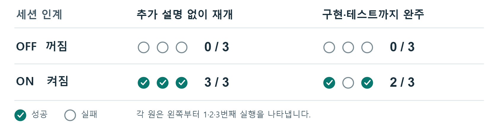

# MyCodexSetting 효과 평가

2026-11-20 · MyCodexSetting 0.5.1 · Codex CLI 0.170.0 · `gpt-6-luna / low`

**세션 인계를 켜자 새 세션이 3회 모두 추가 설명 없이 합의한 문구를 복구했고, 2회는 구현과 테스트까지 마쳤다.** 인계를 껐을 때는 3회 모두 같은 문구를 다시 정해야 했다. 합성 과제 1개를 같은 시작 상태에서 3쌍 비교한 결과다.

인계 작성 시간을 포함하면 평균 실행 시간은 **88초 → 216초**, 평균 입력은 **16.9만 → 41.4만 토큰**이었다. ON에서 멈춘 1회는 아직 합의하지 않은 `null` 정책을 질문했다. 기존 `null` 동작을 유지한 1건도 미완주로 채점하면 ON 완주는 1/3회다.

## 어떤 기능을 비교했나

세 기능을 모두 끈 일반 Codex에서 후보별로 3회 실행했다. 같은 실패가 2회 이상 재현된 과제만 새 OFF/ON 비교에 사용했다.

| 후보 | 선별 결과 | 판정 |
|---|---|---|
| JIT 원본 탐색 | 이전 설정값이 남은 실행은 1/3회였다. | 재현 기준 미달 |
| 세션 인계 | 새 세션이 이미 합의한 빈 입력 문구를 3/3회 놓쳤다. | 비교 대상 |
| billion-context | 초반 예외 규칙은 3/3회 지켰다. 2회는 뒤쪽 목록 두 개의 앞뒤 몇 줄만 출력해 장문 부하를 확인하지 못했다. | 효과 판정 보류 |

파일 읽기·수정·테스트를 사전 검증했고, 같은 스레드의 두 번째 턴 사용량은 로컬과 Langfuse 모두 입력 30,683토큰·출력 241토큰이었다. [평가 설계](docs/superpowers/specs/2026-11-20-codex-cli-context-evaluation.md)
